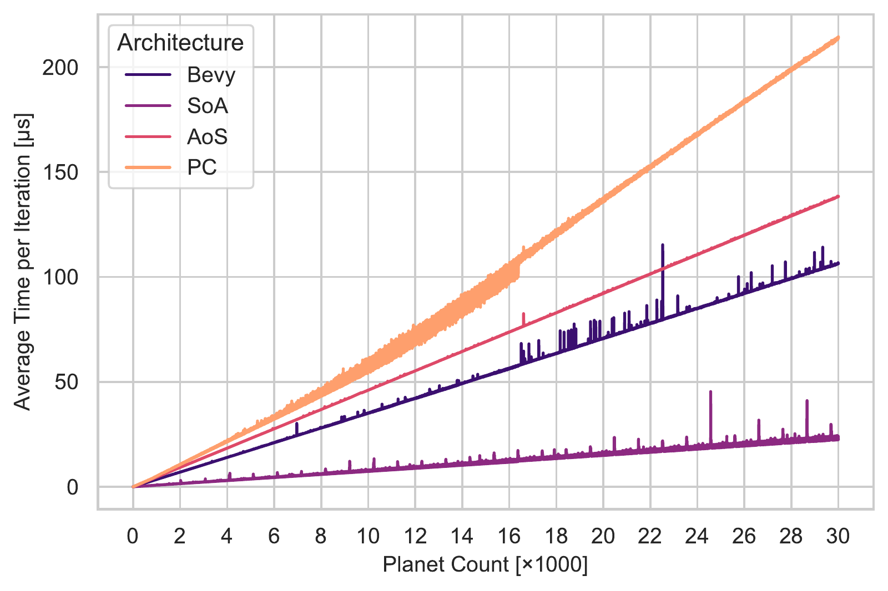
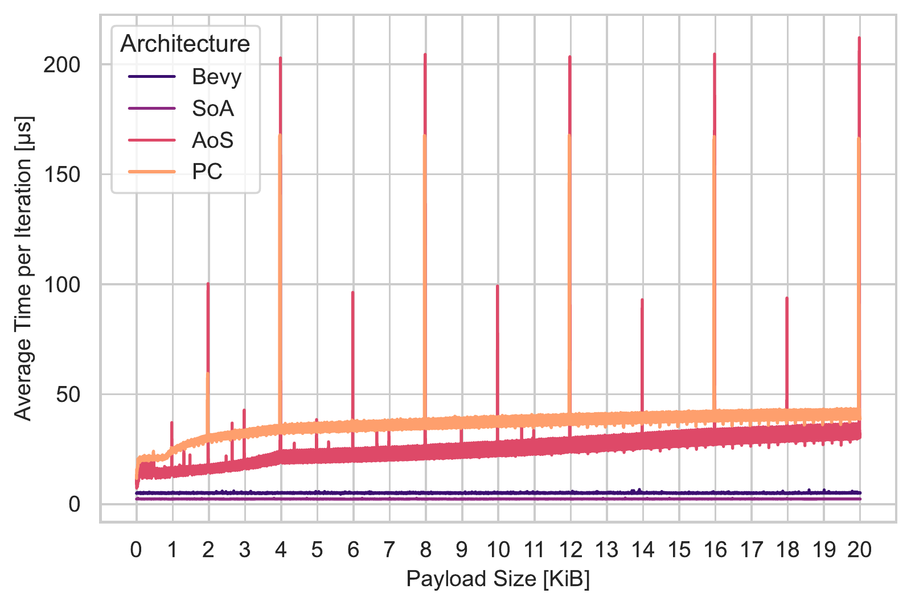
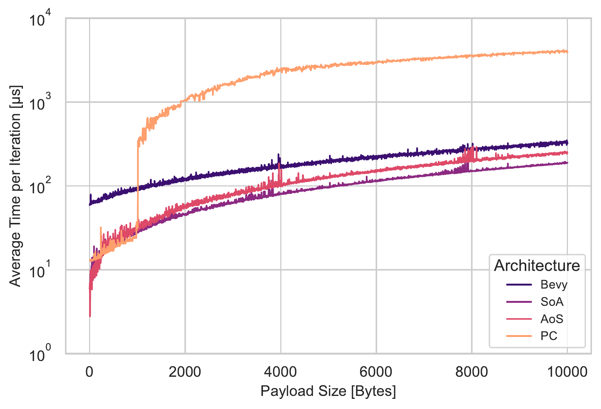
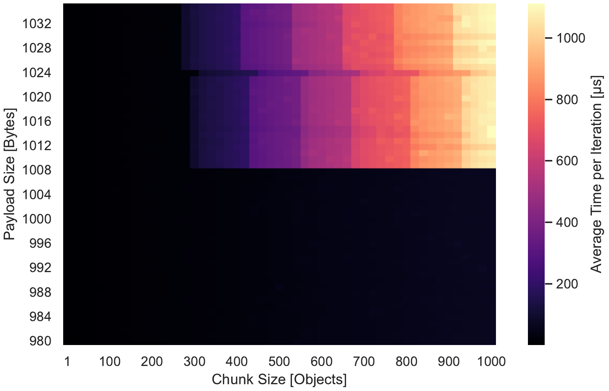
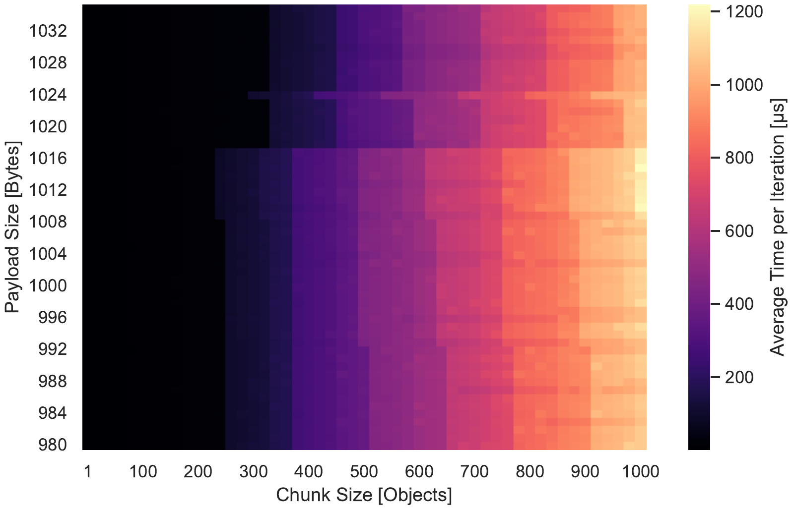

# Rust/DOP Benchmarks
Bachelor's thesis (BSc Computer Science, JKU Linz, 2026) - [Read the thesis (PDF)](Thesis/BA_Rust-DOP.pdf)
  
A command-line benchmark suite comparing the performance of object-oriented and data-oriented memory layouts in Rust.

It runs an identical gravitational simulation across four architectures, namely Pointer Chasing (PC), Array of Structures (AoS), Structure of Arrays (SoA) and Bevy ECS, so that any measured difference can be attributed to the memory layout rather than the workload. Each run appends its timings to a CSV, which the included Python scripts turn into plots.

## 📈 Results

**Scenario 1 – Compute-bound:** SoA processes eight planets per instruction via AVX2, while the interleaved layouts fall back to scalar code.

<p align="center"></p>

**Scenario 2 – Memory-bound:** SoA and Bevy stay flat as the payload grows. AoS and PC spike at power-of-two struct sizes due to L1 cache set conflicts.

<p align="center"></p>

**Scenario 3 – Allocation:** Per-object allocation makes PC an order of magnitude slower than the bulk-allocating architectures.

<p align="center"></p>

### 🔍 The glibc threshold
PC's execution time jumps sharply at exactly 1008 B of payload, i.e. an object size of 1032 B, independent of the chunk size. This matches the default `tcache_max` of glibc's per-thread cache, which only serves objects up to 1032 B. Rerunning with the cache disabled (`GLIBC_TUNABLES=glibc.malloc.tcache_count=0`) removes the edge entirely, confirming the allocator as the cause.

<div align="center">
  <table>
    <tr>
      <th>tcache enabled</th>
      <th>tcache disabled</th>
    </tr>
    <tr>
      <td></td>
      <td></td>
    </tr>
  </table>
</div>

## ℹ️ Arguments
Mandatory argument: `-b <SCENARIO>`

```text
Usage: benchmarks [OPTIONS] --benchmark <SCENARIO>

Options:
  -b, --benchmark <SCENARIO>  Benchmark Scenario                          [possible values: s1, s2, s3, reset]
  -p, --planets <PLANETS>     Planet Count                                [default: 10000]
  -w, --warmups <WARMUPS>     Warmup iterations, discarded                [default: 2500]
  -i, --iterations <ITER>     Measured iterations per sample              [default: 5000]
  -s, --samples <SAMPLES>     Samples per invocation                      [default: 5]
  -c, --chunksize <CHUNK>     Elements added/removed per iteration (S3)   [default: 100]
  -r, --reuse                 Reuse popped values instead of dropping them (S3)
  -d, --debug                 Print a runtime summary to the console
  -h, --help                  Print help
  -V, --version               Print version
```

## 📊 Scenarios
Each scenario isolates a different bottleneck:
- **s1 — Compute-bound:** sweeps the planet count; isolates SIMD vectorization.
- **s2 — Memory-bound:** sweeps the payload size; isolates cache locality.
- **s3 — Allocation/Deallocation:** sweeps payload and chunk size; isolates the allocation strategy. `-r` selects the *reuse* variant, otherwise the popped data is *dropped*.
- **reset:** deletes the generated CSV files to start from a clean slate.

## 🛠️ Example usage
```bash
 # Scenario 1 (compute-bound) with 30k planets
 cargo run --release -- -b s1 -p 30000

 # Scenario 2 (memory-bound), default parameters
 cargo run --release -- -b s2

 # Scenario 3 (alloc/dealloc), reuse variant, chunk size 500, with summary
 cargo run --release -- -b s3 -c 500 -r -d

 # Clear all generated CSV files
 cargo run --release -- -b reset
```
Results are appended to one CSV per architecture and scenario (e.g. `soa.csv`, `bevy.csv`).

## 🔁 Sweeps & plots
The binary itself runs a single configuration, parameter sweeping is done via the scripts:
- **PowerShell (`*.ps1`)** — quick sweeps for debugging on Windows.
- **Bash (`*.sh`)** — the actual data gathering on Ubuntu.

For Scenarios 2 and 3 the payload size is a compile-time constant, so these scripts recompile the binary for every payload value. The **Python scripts (`s*_*.py`)** read the resulting CSVs and generate the SVG figures.

## 📦 Build
1.  **Clone the repository:**
```bash
git clone https://github.com/JaWald/BA-Thesis.git
cd BA-Thesis/Benchmarks
```
2.  **Compile the optimized binary:**
```bash
cargo build --profile o3
```
3.  The executable is created in the `./target/o3/` directory.

> To reproduce the thesis measurements exactly, the benchmarks are built with a custom `o3` profile, `-C target-cpu=native` (for AVX2) and the `mold` linker. See the execution scripts and `Benchmarks/Cargo.toml` for the full flags.
